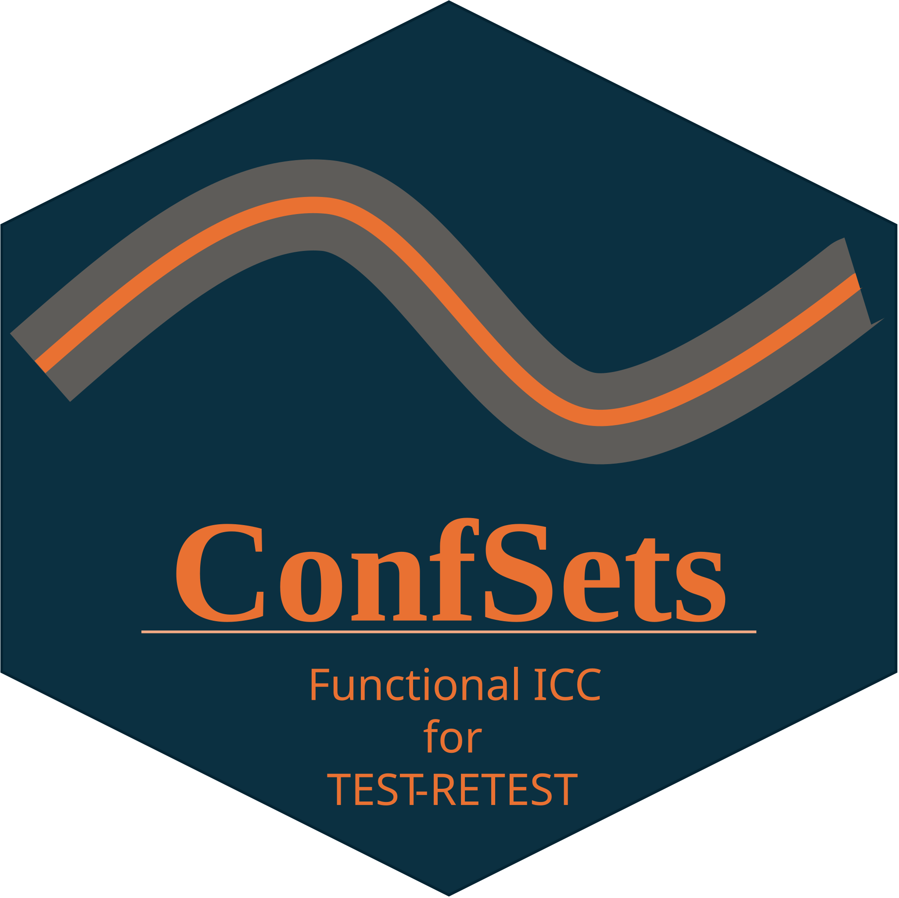

# ConfSets 

**Confidence sets for functional intraclass correlation coefficients (ICC) in test–retest studies.**

ConfSets estimates reliability from repeated curve measurements and supports confidence intervals for integrated ICC values and simultaneous confidence bands for ICC curves. It includes simulated test and retest datasets to help you get started.

## Install

Install the released version from GitHub:

```r
install.packages("remotes")
remotes::install_github(
  "mr-seydi/ConfSets",
  ref = "v1.1.1",
  dependencies = TRUE
)
```

Then load the package:

```r
library(ConfSets)
```

## Main functions

- `functional_ICC()` calculates pointwise and integrated ICC estimates.
- `Conf_sets()` computes confidence sets: `"Rank"` for simultaneous ICC curve bands and `"Normal"` for an integrated ICC confidence interval.
- `plot_ICC()` plots the estimated ICC curve with Rank confidence bands.
- `pointwise_F_bands_ICC()` calculates pointwise F-based confidence bands. These are pointwise bands and do not provide simultaneous coverage.


The functions support `"ICC(A,1)"` (single measurement) and `"ICC(A,k)"` (average measurement) designations where documented. Supply matrices with evaluation points in columns. For unbalanced `"ICC(A,1)"` data, provide the combined individual-ID vector for the test rows followed by the retest rows.

The package documentation describes the data format and methods in more detail.

## Documentation

Read the [rendered vignette](https://mr-seydi.github.io/ConfSets/articles/ConfSets.html) for data-generation details, ICC designations, examples, and confidence-set methods. To run its chunks yourself in RStudio, download the [R Markdown source](https://github.com/mr-seydi/ConfSets/blob/v1.1.1/vignettes/ConfSets.Rmd) and open it in the editor.

Function help is available in R with, for example, `?functional_ICC` and `?Conf_sets`.

## Citation

If you use ConfSets, please cite:

Seydi MR, Pini A, Pataky TC, Schelin L. Confidence sets for intraclass correlation coefficients in test–retest curve measurements. *Journal of Biomechanics*. 2024;173:112232.

```r
citation("ConfSets")
```

## Authors

- Mohammad Reza Seydi — [ORCID](https://orcid.org/0009-0002-3278-5554)

## License

MIT. See [LICENSE](LICENSE) for details.
